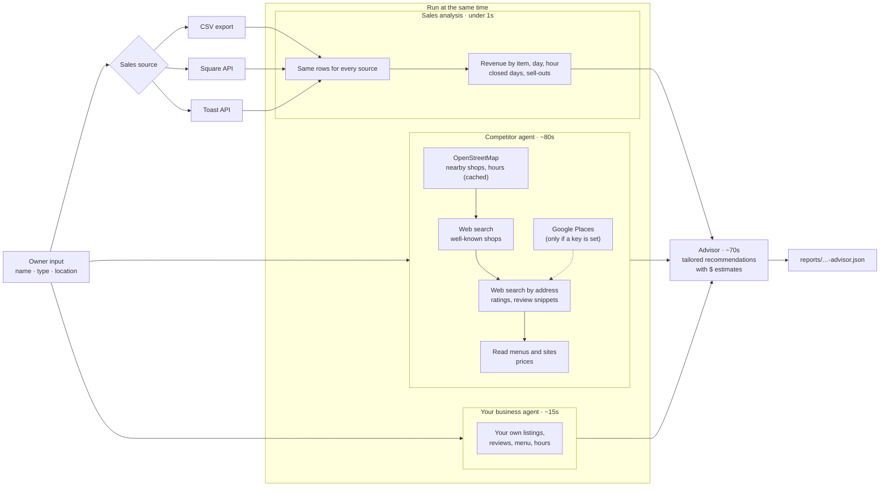

# AE

Tailored advice for small, brick-and-mortar businesses. Given a business, its location and its sales data, it researches nearby competitors and the business's own online presence in parallel, then writes recommendations specific to what that business lacks or could change, with estimated dollar impact.



## Setup

```sh
python3 -m venv .venv
.venv/bin/pip install -r requirements.txt
```

Put your keys in a `.env` file at the repo root (it's gitignored):

```
ANTHROPIC_API_KEY=sk-ant-...
TAVILY_API_KEY=tvly-...
GOOGLE_PLACES_API_KEY=...
```

`GOOGLE_PLACES_API_KEY` is optional and paid. Without it, the agent finds competitors with OpenStreetMap (free, no key) and gets ratings and reviews from web search. To get a Google key: in the [Google Cloud console](https://console.cloud.google.com/), create a project, enable billing and **Places API (New)**, then create an API key under APIs & Services → Credentials. Restrict the key to Places API (New).

## Run

Full pipeline (about 2.5 minutes):

```sh
.venv/bin/python agent/advisor.py "Test Bakery" bakery "Capitol Hill, Seattle" --sales data/sample_sales.csv
```

`--sales` takes a Square "Items" sales export (CSV with Date, Time, Category, Item, Qty, Gross Sales). `data/sample_sales.csv` is **fake** data for a fictional bakery, made by `scripts/make_sample_sales.py`.

The report is saved to `reports/<business>-<date>-advisor.json`. Progress and timings print as it runs.

### Pulling sales straight from Square or Toast

Instead of a CSV, pass `--sales square` or `--sales toast` (and optionally `--days 56`) to pull item-level sales from the POS API. Add the credentials to `.env`:

```
# Square: create an app at developer.squareup.com. The sandbox token works with Square's test data.
SQUARE_ACCESS_TOKEN=...
SQUARE_ENVIRONMENT=sandbox        # or production
SQUARE_LOCATION_ID=...            # optional; defaults to the first location

# Toast: a restaurant admin creates "Standard API access" credentials in Toast Web
# (Integrations → Toast API access → Manage credentials) with read access to orders.
TOAST_CLIENT_ID=...
TOAST_CLIENT_SECRET=...
TOAST_RESTAURANT_GUID=...
```

The Toast integration is written from Toast's docs and hasn't been tested against a live account yet. Keep any real owner's sales data out of the repo (e.g. in `private/`, which is gitignored).

### Monitoring: alert the owner when something changes

```sh
.venv/bin/python agent/monitor.py "Sea Wolf Bakers" bakery "Fremont, Seattle" --sms +12065550123
```

The first run saves a baseline of the competitors. Each later run re-checks the same competitors (plus a search for new openings and closures), compares with the last snapshot, and if anything material changed (a new shop, a closure, a price change, new hours) prints a short message, appends it to `state/<business>/notifications.log`, and texts it to `--sms` if Twilio is configured (`TWILIO_ACCOUNT_SID`, `TWILIO_AUTH_TOKEN`, `TWILIO_FROM` in `.env`). Run it on a schedule, e.g. Monday, Wednesday and Friday mornings.

### Supabase (for the app)

The schema is in [`supabase/migrations/`](supabase/migrations/). Apply it in the Supabase SQL editor (or with `supabase db push`). Tables:

| Table | What's in it | App access |
|---|---|---|
| `businesses` | One row per shop: name, type, location, time zone, monitoring on/off, notify hour, SMS/email opt-in | Owner reads and edits their own |
| `competitors` | Latest known state of each tracked competitor (rating, hours, status, prices in `details`) | Owner reads |
| `changes` | Each change detected (kind, competitor, before → after, evidence, why it matters) | Owner reads |
| `notifications` | The in-app feed plus outgoing texts/emails with their send status | Owner reads, can set `read_at` |
| `snapshots` | Full research from each run | Owner reads |
| `monitor_runs` | Each scheduled check: status, error, number of changes ("last checked" in the app) | Owner reads |
| `advisor_reports` | Full advisor reports | Owner reads |

Row level security limits signed-in owners to their own businesses. The Python monitor writes with the service-role key, which bypasses it, so that key must stay on the server and never go in the Lovable frontend. Add to `.env` on the machine that runs the monitor:

```
SUPABASE_URL=https://<project>.supabase.co
SUPABASE_SERVICE_ROLE_KEY=...
RESEND_API_KEY=...        # optional, for email
RESEND_FROM=alerts@yourdomain.com
```

Then schedule:

```sh
.venv/bin/python agent/monitor.py --all       # Mon/Wed/Fri: check every business with monitoring on
.venv/bin/python agent/monitor.py --deliver   # hourly: send texts/emails at each owner's notify hour
```

Each check adds the alert to the in-app feed right away and queues a text/email for the owner's `notify_hour` (default 2pm local).

Competitor research only:

```sh
.venv/bin/python agent/competitor_agent.py "Test Bakery" bakery "Capitol Hill, Seattle"
```

## Example

[`examples/capitol-hill-bakery-advisor.json`](examples/capitol-hill-bakery-advisor.json): full advisor report for the fictional "Test Bakery" on Capitol Hill, using the fake sample sales.

## Files

- `agent/advisor.py`: runs the three parts in parallel and writes the tailored recommendations
- `agent/competitor_agent.py`: competitor research agent and its tools (OpenStreetMap, Tavily, optional Google Places)
- `agent/business_agent.py`: sales-data analysis and the agent that researches the business's own online presence
- `agent/pos.py`: pulls item-level sales from the Square and Toast APIs
- `agent/monitor.py`: re-checks competitors on a schedule and notifies the owner of changes (local files or Supabase)
- `agent/supabase_store.py`: reads and writes the Supabase tables
- `supabase/migrations/`: the database schema and access rules
- `agent/agent_loop.py`: shared agent loop that runs each turn's tool calls in parallel
- `agent/sources.py`: which sites web search uses for listings and reviews
- `scripts/make_sample_sales.py`: generates the fake sample sales data
