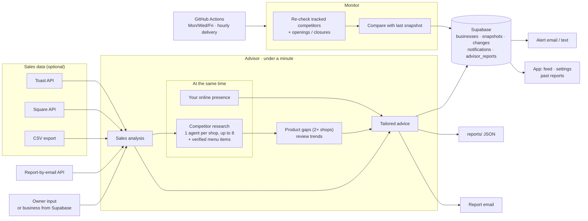

# AE

Python research and advice for small, brick-and-mortar businesses, running on Claude Sonnet 5.5. The **advisor** analyzes the owner's sales (optional), researches up to 8 nearby competitors in parallel and the owner's own online presence, finds product gaps, and writes tailored recommendations in under a minute; it can save the report to Supabase and email it. The **monitor** re-checks each business's competitors three times a week on GitHub Actions and alerts the owner to real changes.



This repository is the Python backend: functions, command-line tools, a small report-by-email API (`agent/api.py`), the Supabase schema, and the scheduled monitor. The app frontend lives elsewhere. See [the backend integration contract](docs/backend-integration.md) and [frontend integration](docs/frontend-integration.md).

## Setup

```sh
python3 -m venv .venv
.venv/bin/pip install -r requirements.txt
cp .env.example .env
```

Set `ANTHROPIC_API_KEY` and `TAVILY_API_KEY` in `.env` for live research. Signing in to Tavily MCP in Codex does not supply this application's API key. Every step runs on Claude Sonnet 5.5 by default; `ANTHROPIC_MODEL` overrides it (use a model available to your account).

`GOOGLE_PLACES_API_KEY` is optional and paid. Without it, OpenStreetMap supplies discovery and Tavily searches accessible web sources. To configure Google, enable billing and **Places API (New)** in the [Google Cloud console](https://console.cloud.google.com/), then create a key restricted to that API. Google Places reviews are a small selected sample, not a complete chronological review feed.

## Run the advisor

```sh
.venv/bin/python agent/advisor.py "Test Bakery" bakery "Capitol Hill, Seattle" --sales data/sample_sales.csv
```

A run takes about 50 seconds:
1. **Sales analysis** (Python, instant for a CSV) finds the owner's top sellers.
2. **At the same time:** competitor discovery (OpenStreetMap plus one web search, then one short call picks up to 8 competitors) followed by **one quick agent per competitor, all in parallel**, each pricing the owner's top sellers; and research on the owner's own online presence.
3. **Advice:** product analysis, then tailored recommendations.

All steps use Claude Sonnet 5.5. `ADVISOR_MODEL` and `FAST_MODEL` (competitor and presence agents) override the model per step, and `MAX_COMPETITORS` (default 8) sets how many shops are researched.

`--sales` accepts a Square Items export with `Date`, `Time`, `Item`, `Qty`, and `Gross Sales` columns; `Category` is optional. `data/sample_sales.csv` is **synthetic data for a fictional bakery**, generated by `scripts/make_sample_sales.py` and automatically labeled synthetic. Use `--synthetic-sales` for other demonstration CSV files. Its recommendations and dollar scenarios must not be presented as results from a real business.

Products found in sales are known offerings, but the sales export is not assumed to be the complete current menu. Use `--owner-menu` with an owner-confirmed menu to establish missing products. Each advisor report is saved with a unique filename under `reports/`; the command prints the output path.

```sh
.venv/bin/python agent/advisor.py "Moonrise Bakery" bakery "Queen Anne, Seattle" \
  --sales /path/to/your-sales.csv \
  --owner-menu examples/moonrise-owner-menu.example.json
```

The Moonrise menu file is an **unverified template**. Replace its indicative products with the owner's list. Set `confirmed_complete` to `true` and `confirmed_at` to the confirmation date only when the owner confirms completeness.

The advisor also accepts `--website`, `--max-workers`, `--reports-dir`, and `--no-history`.

**Product gaps:** each competitor agent also records the menu items on pages it read, with a plain category ("Twice-Baked Almond Croissant" → "almond croissant") so the same product groups across shops. Items not found verbatim on a page the agent read are dropped. A product is a gap only when **at least 2 competitors** sell it and it isn't among the owner's products (`advisor.MIN_GAP_COMPETITORS`), so one shop's specialty doesn't show up. Gaps stay `needs_confirmation` unless the owner supplied a confirmed complete menu. Shops whose menus can't be read (no website, or a menu only on a delivery app) add no items.

**Limits to know:** no review observations are collected, so review trends stay empty in advisor reports. The quick shortlist sometimes skips well-known nearby shops in favor of smaller ones (in one Fremont test it missed Petit Pierre, Fresh Flours and Rosellini's), so check the shortlist before showing a report to an owner. For the slower, evidence-validated collection, use `agent/competitor_agent.py` below.

Run just the competitor part with `python agent/fast_competitors.py "Test Bakery" bakery "Capitol Hill, Seattle"`.

### Email the report

Add `--email you@example.com` to send the finished report as an HTML email (plain-text version included):

```sh
.venv/bin/python agent/advisor.py "Test Bakery" bakery "Capitol Hill, Seattle" --sales data/sample_sales.csv --email owner@example.com
```

Preview it without sending anything (writes `reports/email-preview.html`): add `--email-preview`.
Send a saved report later: `python agent/notify.py reports/<file>-advisor.json owner@example.com`.

Setup, in `.env`. **Resend** (same keys the competitor alerts use) is used if set: `RESEND_API_KEY` and `RESEND_FROM` (Resend's test sender only delivers to your own account email until you verify a domain). Otherwise any SMTP provider works; the Gmail example:

```
SMTP_USER=you@gmail.com
SMTP_PASSWORD=<an app password>      # Google Account > Security > 2-Step Verification > App passwords. Never your real password.
# optional: SMTP_HOST=smtp.gmail.com  SMTP_PORT=587  EMAIL_FROM="LocalEdge <you@gmail.com>"
```

Notes:
- The report is saved before the email is sent, so a mail problem never loses it.
- Exactly one recipient; lists and anything that could inject headers are rejected.
- Report text comes from web pages and model output, so it is HTML-escaped. No tracking pixels or links.
- Tests (no network, SMTP mocked): `python tests/test_notify.py`.
- With `--business-id`, Supabase still stores the report; `--email` sends a copy as well.

### Report-by-email API

A small standalone service: a user enters their business and email, the report is researched in the background (no sales file needed) and emailed when ready, so nobody waits on a loading screen.

```sh
.venv/bin/uvicorn api:app --app-dir agent --port 8100
```

| Endpoint | |
|---|---|
| `POST /api/report-email` | `{business, business_type, location, email, website?}` → `202 {id, status: "running"}` right away |
| `GET /api/report-email/{id}` | `{status: running/done/error, emailed, error, report}` (the report is included when done) |
| `GET /api/health` | shows whether email is configured |

Errors are `{"error": "plain-English message"}`. Without sales data the advice rests on competitor research and the owner's online presence, and dollar estimates are left blank.

Because this can spend API credit and send email, it is rate limited: one report per address per 10 minutes (`EMAIL_COOLDOWN_SECS`) and 30 per hour overall (`MAX_REPORTS_PER_HOUR`). Jobs are kept in memory, so they are lost on restart (the report JSON is also saved in `reports/`). Tests (mocked, no cost, nothing sent): `python tests/test_api.py`.

### Pull sales from Square or Toast

Instead of a CSV, pass `--sales square` or `--sales toast`. `--days 56` sets the lookback period for POS sales; the default is 56 days. Both APIs produce the same item-level row format used by CSV analysis, including fractional quantities.

```sh
.venv/bin/python agent/advisor.py "My Cafe" cafe "Ballard, Seattle" --sales square --days 56
.venv/bin/python agent/advisor.py "My Cafe" cafe "Ballard, Seattle" --sales toast --days 56
```

Add the corresponding credentials to `.env`:

```dotenv
# Square: create an app at developer.squareup.com.
SQUARE_ACCESS_TOKEN=...
SQUARE_ENVIRONMENT=sandbox
# Choose production only for a production account/token.
SQUARE_LOCATION_ID=...
# Optional; without it the integration uses the account's first location.

# Toast: a restaurant admin creates Standard API access credentials in Toast Web
# (Integrations → Toast API access → Manage credentials), with read access to orders.
TOAST_CLIENT_ID=...
TOAST_CLIENT_SECRET=...
TOAST_RESTAURANT_GUID=...
# Optional; defaults to the production API host.
# TOAST_API_HOST=https://ws-api.toasttab.com
```

Square sandbox sales are automatically labeled synthetic. Use `--synthetic-sales` for other test feeds. The Toast integration has not been tested against a live account. Keep real owners' sales files out of Git; `private/` is gitignored.

## Monitoring: alert the owner when something changes

```sh
.venv/bin/python agent/monitor.py "Sea Wolf Bakers" bakery "Fremont, Seattle" --sms +12065550123
```

The first run saves a baseline of the competitors. Each later run re-checks the same competitors (plus a search for new openings and closures), compares with the last snapshot, and if anything material changed (a new shop, a closure, a price change, new hours) prints a short message, appends it to `state/<business>/notifications.log`, and texts it to `--sms` if Twilio is configured (`TWILIO_ACCOUNT_SID`, `TWILIO_AUTH_TOKEN`, `TWILIO_FROM` in `.env`). Run it on a schedule, e.g. Monday, Wednesday and Friday mornings.

## Supabase (for the app)

The schema is in [`supabase/migrations/`](supabase/migrations/). Apply it in the Supabase SQL editor (or with `supabase db push`). Tables:

| Table | What's in it | App access |
|---|---|---|
| `businesses` | One row per shop: name, type, location, time zone, monitoring on/off, notify hour, SMS/email opt-in | Owner reads and edits their own |
| `competitors` | Latest known state of each tracked competitor (rating, hours, status, prices in `details`) | Owner reads |
| `changes` | Each change detected (kind, competitor, before → after, evidence, why it matters) | Owner reads |
| `notifications` | The in-app feed plus outgoing texts/emails with their send status | Owner reads, can set `read_at` |
| `snapshots` | Full research from each run | Owner reads |
| `monitor_runs` | Each scheduled check: status, error, number of changes ("last checked" in the app) | Owner reads |
| `advisor_reports` | Full advisor reports | Owner reads |

Row level security limits signed-in owners to their own businesses. The Python monitor writes with the service-role key, which bypasses it, so that key must stay on the server and never go in the Lovable frontend. Add to `.env` on the machine that runs the monitor:

```
SUPABASE_URL=https://<project>.supabase.co
SUPABASE_SERVICE_ROLE_KEY=...
RESEND_API_KEY=...        # optional, for email
RESEND_FROM=alerts@yourdomain.com
```

Then schedule:

```sh
.venv/bin/python agent/monitor.py --all       # Mon/Wed/Fri: check every business with monitoring on
.venv/bin/python agent/monitor.py --deliver   # hourly: send texts/emails at each owner's notify hour
```

### Scheduling in the cloud (GitHub Actions)

[`.github/workflows/monitor.yml`](.github/workflows/monitor.yml) runs `monitor.py --all` Mon/Wed/Fri at 15:00 UTC (8am Seattle in summer, 7am in winter) and `monitor.py --deliver` every hour, on GitHub's servers. It can also be started by hand from the repo's **Actions** tab ("Competitor monitor" → **Run workflow**).

To turn it on:
1. A repo admin adds these under **Settings → Secrets and variables → Actions → New repository secret**: `ANTHROPIC_API_KEY`, `TAVILY_API_KEY`, `SUPABASE_URL`, `SUPABASE_SERVICE_ROLE_KEY`, and optionally `GOOGLE_PLACES_API_KEY`, `RESEND_API_KEY`, `RESEND_FROM`, `TWILIO_ACCOUNT_SID`, `TWILIO_AUTH_TOKEN`, `TWILIO_FROM`.
2. Put the workflow file on `main`. GitHub only runs scheduled workflows from the default branch. The workflow checks out the `app` branch to run the Python code, so only that one file needs to be on `main`.

Scheduled runs can start a few minutes late. Once the cloud schedule works, remove the laptop cron job (`crontab -r`) so businesses aren't checked twice.

To make an advisor report for a business stored in Supabase, so the owner can look back on it in the app:

```sh
.venv/bin/python agent/advisor.py --business-id UUID --sales square
```

It uses the business's stored name, type, location and website, saves the report to `advisor_reports` (and to `reports/` as usual), and prints the new row id. From Python, call `advisor.run_for_business(business_id, sales_source)`. In the app, list past reports newest first with `select=id,created_at,advice->>snapshot,sales_summary->>is_synthetic&order=created_at.desc` and load the full `advice` when one is opened. `sales_summary.is_synthetic` marks demo reports.

Each check adds the alert to the in-app feed right away and queues a text/email for the owner's `notify_hour` (default 2pm local). The baseline uses the default multi-agent research; repeat checks re-research the same tracked competitors with the single-agent collector, which is the one that accepts a fixed list.

## Run competitor and product research

```sh
.venv/bin/python agent/competitor_agent.py "Test Bakery" bakery "Capitol Hill, Seattle" \
  --strategy multi --max-agents 3 --max-workers 4
```

For product comparisons, add `--owner-menu path/to/menu.json`. Other controls are `--window-days 30`, `--min-reviews 10`, `--as-of YYYY-MM-DD`, `--reports-dir reports`, and `--no-history`.

Historical `--as-of` dates are supported only with offline `--evidence`; live pages are observed today. Worker counts are 1–10 and comparison windows are 1–365 days.

The collector reports competitor facts and source observations. The analysis layer calculates potential product gaps and review trends; the advisor owns tailored recommendations and any explicitly labeled financial scenarios. Collection runs only when invoked; recurring checks are handled by the monitor (see Monitoring above).

### Independent website specialists

The default `multi` strategy first targets up to eight nearby branches in discovery. It then gives the same verified branch identities to five separate Claude conversations, each with its own tool state, source ledger, domain restrictions, and retrieval budget:

| Agent | Assigned sources and task |
|---|---|
| `official_menus` | Discovered official websites: listed products, prices, and hours. Skipped if no official domains were verified. |
| `ordering_prices` | Public Square, Toast, and Clover ordering pages: products and online-ordering prices, labeled separately from in-store prices. |
| `yelp_reviews` | Indexed Yelp listings and search snippets only. No direct page extraction or claim to full collected reviews. |
| `tripadvisor_reviews` | Indexed TripAdvisor listings and search snippets only, with the same limitation. |
| `google_reviews` | Exact Google listings; selected Places review samples if a key is configured, otherwise indexed Google snippets. |

`--max-agents` limits simultaneous competitor specialists (1–6, default 3). The five specialists are queued when the cap is smaller than five. `--max-workers` separately limits concurrent tool calls **inside each agent** (1–10, default 4). The advisor's own-presence and sales stages remain independently parallel, so neither option is a global process-wide request cap. `--strategy single` keeps the original one-conversation competitor collector.

Once specialists finish, Python merges validated facts in a fixed order. Conflicting ratings and other scalar facts stay unknown; prices are retained as source-specific claims, not averaged. `agent_runs` records statuses, elapsed time, and observation counts, while `source_reports` preserves attribution. A failed or skipped source produces a `partial` collection with caveats; other successful sources remain usable. Discovery failure or failure of every scheduled specialist raises an error. These limits bound work; no live speedup is assumed.

## Try product analysis without API keys

```sh
.venv/bin/python agent/competitor_agent.py "Demo Bakery" bakery "Queen Anne, Seattle" \
  --evidence examples/product-opportunity-demo.json \
  --owner-menu examples/demo-owner-menu.json \
  --as-of 2026-10-25 --window-days 30 --min-reviews 10 \
  --reports-dir reports/demo --no-history
```

This offline path makes no API calls, including to Claude. Dependencies still need to be installed. All businesses, addresses, feedback, prices, and URLs in these two demo files are **synthetic**. The `example.com` links are placeholders and are not fetched.

The fixture contains 12 dated review texts in each comparison period, with positive pistachio-croissant mentions rising from 3/12 to 9/12. It also includes a duplicate and a search snippet to exercise filtering. This illustrates a change in the collected sample, not sales growth or profit. `--evidence` accepts a raw evidence bundle; replaying a complete report is described in [the integration contract](docs/backend-integration.md#replay-an-exported-report).

## How to interpret the results

- A menu listing proves only that the product appeared in the retrieved evidence. It does not prove availability, sales volume, or profitability.
- A missing product is confirmed only against a complete, recently confirmed owner menu. Otherwise it remains a candidate requiring owner confirmation.
- Review trends use deduplicated, dated review texts from matching business/address/source groups in two adjacent windows. Standardized shares hold those groups' weights fixed. The default requires at least 10 eligible reviews and 3 reviews with a positive product mention or request per period.
- Search snippets, editorial summaries, and selected Google Places reviews do not qualify for temporal trends. A displayed “233 reviews” count is not 233 collected records. Relative dates such as “two weeks ago” are not substituted with collection dates.
- History is scoped by business name, location, and collection mode. Imported evidence is kept separate from live collection. Repeated observations are deduplicated; saving a report again does not create growth.
- Collection coverage may be incomplete and unrepresentative. Source URLs, branch identity, dates, and text are retained; automated classification still needs review. Import only feedback you have permission to process.
- Review mentions do not establish sales or financial impact. Advisor estimates must remain labeled scenarios grounded in the owner's data and assumptions. Transaction timing alone does not prove stockouts or operating hours; validate those with the owner.

## More docs

- [`docs/backend-integration.md`](docs/backend-integration.md): Python imports, report fields, and replaying evidence.
- [`docs/email-reports.md`](docs/email-reports.md): email delivery and the report API: what was built, measured timings, known limits.
- [`docs/frontend-integration.md`](docs/frontend-integration.md): how the frontend adds "Email me this report".

## Tests

The Python tests run without live service credentials:

```sh
.venv/bin/python -m unittest discover -s tests -v
```

## Files

- `agent/advisor.py`: the main workflow: sales, competitor and online-presence research, and tailored advice.
- `agent/competitor_agent.py`: facts-only collector, analyzed `research(...)` entry point, and CLI.
- `agent/business_agent.py`: sales calculations and the owner's online-presence research.
- `agent/pos.py`: Square and Toast item-level sales retrieval.
- `agent/fast_competitors.py`: the advisor's competitor research (one quick agent per competitor, in parallel).
- `agent/source_agents.py`: discovery, independent website specialists, source budgets, and deterministic merging.
- `agent/agent_loop.py`: shared loop with bounded tool context and parallel retrieval.
- `agent/market_intelligence.py`: deterministic menu-gap and review-trend analysis.
- `agent/evidence_store.py`: retrieved-source validation, scoped history, and report persistence.
- `agent/monitor.py`: re-checks competitors on a schedule and notifies the owner of changes (local files or Supabase).
- `agent/supabase_store.py`: reads and writes the Supabase tables.
- `supabase/migrations/`: the database schema and access rules.
- `agent/sources.py`: listing/review source configuration.
- `scripts/make_sample_sales.py`: generates synthetic sales data.
- `scripts/run_monitor.sh`: cron wrapper for the monitor.
- `examples/capitol-hill-bakery-advisor.json`: legacy advisor output for fictional Test Bakery using synthetic sales; not a dated review dataset for trend analysis.

## Nearby prototype (Next.js, from main)

Nearby helps small-business owners compare their website with one to three competitors, review recommendations with sources, and edit the accompanying drafts. It also has a Square inventory workspace for stock by location.

### Run locally

Requires Node.js **22.13+** and npm.

```sh
git clone https://github.com/jaggerbaldevia-star/AE.git
cd AE
npm run install:ci
npm run dev
```

Open the local URL printed by the dev server. The Seattle bakery example works without an API credential. For live research, create an untracked `.dev.vars` file using `.env.example` as a template, then set your own `ANTHROPIC_API_KEY` there. Keep real credentials out of Git.

### What works

- Website and competitor inputs, plus an optional business goal and questionnaire about the business, customers, existing efforts, and time, budget or capacity constraints.
- Claude research restricted to the supplied business domains.
- Up to three recommendations with source links and retrieval dates.
- Form inputs saved in the browser before research runs, plus an owner-provided business brief kept separate from website evidence.
- Editable drafts with browser autosave, copy, and Markdown export, including the submitted business brief.
- Explicit missing-evidence, stale-source, and provider-error handling.

### Square inventory

Open **Inventory** to explore fictional sample stock or connect a Square sandbox account. The screen supports location selection, product/SKU search, low-stock flags, browser-local thresholds, refresh, and CSV export. It reads Square counts without changing them. Live counts require server-side `SQUARE_ACCESS_TOKEN` and `SQUARE_ENVIRONMENT=sandbox`; see [Square setup](SQUARE.md). This is a single-merchant prototype.

### Checks

```sh
npx tsc --noEmit
node --test tests/backend.test.mjs tests/inventory.test.mjs
npm run build
```

### Deployment and data

The questionnaire is optional. Owners still need their website and one to three competitor websites. Answers help tailor recommendations to the owner's goal and constraints; they are self-reported information, not independently verified facts.

The prototype is intended for local use or a private Sites deployment. The research and inventory APIs rely on the private Sites access boundary; add server-side authentication and durable usage limits before deploying it publicly elsewhere. This repository contains no live Site identity or API credential. Form inputs, reports and draft edits save in the browser. URLs, goals and questionnaire answers are sent to Claude only when research is submitted; do not enter customer personal data. Drafts are never emailed or posted automatically.

See [the implementation and setup guide](NEARBY.md), [backend checks](tests/README.md), and [the original project meeting notes](thought%20overview).
